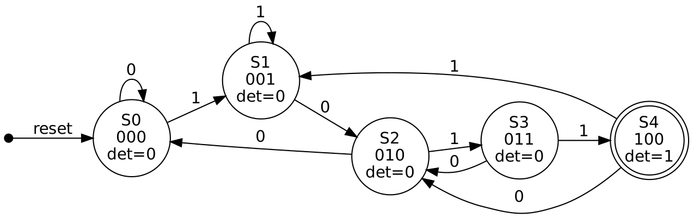

# Part II: Design and Verification of an Overlapping 1011 Sequence Detector

## II.1 Objective

Part II adds one new design to the project: a serial detector for the bit pattern `1011`, built as a five-state Moore finite-state machine (FSM) that supports overlapping matches. The detector is verified with a self-checking, black-box testbench. The testbench derives every expected output from the input-bit history alone and checks the `detected` output after every sampled bit. The design is in `rtl/sequence_detector.sv`, the testbench is in `tb/tb_sequence_detector.sv`, and the regression is run with `scripts/run_part2.sh`.

## II.2 Design (II.A)

### II.2.1 Interface and timing convention

| Port | Direction | Width | Description |
|---|---|---|---|
| `clk` | input | 1 | Clock. All state changes occur on the rising edge. |
| `reset` | input | 1 | Synchronous, active-high reset. Forces the state to S0 on the next rising edge, regardless of `bit_in`. |
| `bit_in` | input | 1 | Serial input. One bit is sampled on each rising edge. |
| `detected` | output | 1 | Moore output. High exactly while the FSM is in S4 (a completed match). |

When the final `1` of `1011` is sampled at a rising edge, the state becomes S4 and `detected` is high after that edge. On the following rising edge the FSM moves according to the next input bit, so each match produces a one-cycle pulse. No extra cycles are inserted, and the output does not depend on the current value of `bit_in`.

### II.2.2 States, encoding and transitions

The five states are given a 3-bit binary encoding, the minimum number of bits that can represent five states. Each state records the longest suffix of the input so far that is also a prefix of `1011`.

| State | Encoding | Meaning (last useful prefix) | `bit_in` = 0 | `bit_in` = 1 | `detected` |
|---|---|---|---|---|---|
| S0 | `000` | no useful prefix | S0 | S1 | 0 |
| S1 | `001` | `1` | S2 | S1 | 0 |
| S2 | `010` | `10` | S0 | S3 | 0 |
| S3 | `011` | `101` | S2 | S4 | 0 |
| S4 | `100` | `1011` matched | S2 | S1 | 1 |
| unused | `101`, `110`, `111` | illegal | S0 | S0 | 0 |

*Table II-1. State encoding and next-state table of the sequence detector.*

The fallback transitions are what make overlapping detection work. From S4, the input so far ends in `1011`. A following `0` leaves the suffix `10`, so the FSM goes to S2, and a following `1` leaves the suffix `1`, so it goes to S1. Neither transition returns to S0, which is why the stream `1011011` produces a second match after only three more bits. Similarly, from S3 (`101`) a `0` leaves the suffix `10`, so the FSM falls back to S2 instead of S0. From S1, a second `1` keeps the prefix `1`, and from S2, the input `100` contains no useful prefix, so that is the only case besides S0 on `0` that returns to S0.

### II.2.3 State diagram



*Figure II-1. State diagram of the overlapping `1011` Moore detector. Each state shows its name, its binary encoding and its Moore output (`det`). Edge labels are the sampled value of `bit_in`. The reset arrow enters S0, and the double circle marks the accepting state S4.*

### II.2.4 RTL structure

The RTL follows the required coding style:

* **State register.** An `always_ff @(posedge clk)` block loads S0 when `reset` is high and `next_state` otherwise. Reset is therefore synchronous and active high.
* **Next-state logic.** An `always_comb` block assigns `next_state = S0` before a `case (state)` statement that implements Table II-1. A `default:` arm sends the three unused encodings to S0.
* **Output logic.** `assign detected = (state == S4);` makes the output a pure function of the state, which is the defining property of a Moore machine.

```systemverilog
always_ff @(posedge clk) begin
  if (reset) state <= S0;
  else       state <= next_state;
end

always_comb begin
  next_state = S0;                       // safe default
  case (state)
    S0: next_state = bit_in ? S1 : S0;
    S1: next_state = bit_in ? S1 : S2;
    S2: next_state = bit_in ? S3 : S0;
    S3: next_state = bit_in ? S4 : S2;
    S4: next_state = bit_in ? S1 : S2;   // overlap
    default: next_state = S0;            // unused encodings recover to S0
  endcase
end

assign detected = (state == S4);
```

The assignment before the `case` statement means `next_state` is assigned on every path, so no latch is inferred. The `default` arm gives a safe recovery: if the state register ever holds an unused encoding, the FSM returns to S0 on the next rising edge, and because `detected` compares against S4 only, an illegal state can never raise a false detection.

## II.3 Self-checking testbench (II.B)

### II.3.1 Architecture

The testbench instantiates the detector and drives it with a 10 ns clock. It treats the DUT as a black box: it never reads `dut.state` and does not depend on the state encoding. Stimulus changes on the falling edge, and the DUT samples on the rising edge, so there is no race between the driver and the design. Each test stream is described as a string of characters (`0` or `1` samples one bit, `R` applies one reset edge, `_` is a visual separator), and a single task `run_stream()` applies it. Every stream begins with its own reset edge, so the streams are independent of each other and of their order.

### II.3.2 Independent oracle

The expected output is computed by a reference model that shares no logic with the FSM:

1. **Sliding-window model.** A 4-bit shift register holds the last four bits sampled since the most recent reset. After each sampled bit the expected output is `detected = (window == 4'b1011)`. This is a direct restatement of the specification ("the last four bits are 1011") and contains no states, no transitions and no knowledge of prefixes. Overlap is handled automatically, because the window simply slides by one bit on each sample.
2. **Reset model.** On a reset edge the window is cleared to `0000`. Because the pattern begins with `1`, the window cannot equal `1011` until four new bits have been sampled after the reset. Any partial progress from before a reset can therefore never contribute to a match, and no separate bit counter is needed.

Because the FSM encodes the pattern as states and transitions while the oracle compares raw bit history, a wrong or missing transition in the FSM produces a disagreement in `detected` at some later sample, which the testbench reports.

### II.3.3 Checking and diagnostics

* `detected` is checked 1 ns after **every** rising edge on which a bit is sampled, and also after every reset edge, where it must be 0.
* During every reset edge, `bit_in` is driven to 1 to show that the input is ignored while reset is active.
* **First-failure diagnostic.** At the first mismatch the testbench prints the stream name, cycle number, simulation time, bit index since the last reset, the full input history since that reset, the expected and observed values, and whether the error is a *missed* detection or a *false* detection. Later mismatches print one line each.
* At the end the testbench prints a summary. If any check failed it prints `TEST FAILED` and calls `$fatal`, so the simulator exits with a non-zero status and the regression script reports a failure.
* Every checked cycle is written to `sim/part2_timing.csv` with the columns cycle, stream, bit index, `bit_in`, expected `detected` and observed `detected`. This file is the source of the timing table in Section II.6.

### II.3.4 Test streams

Eight directed streams are applied. Table II-2 maps each one to the requirement it covers.

| # | Stream name | Input | Requirement covered | Expected detections | Key transitions exercised |
|---|---|---|---|---|---|
| 1 | `basic_1011` | `1011` | Single match | after bit 4 | S0→S1→S2→S3→S4 |
| 2 | `overlap_1011011` | `1011011` | Overlapping matches | after bits 4 and 7 | S4 −0→ S2 (overlap) |
| 3 | `all_zeros` | `00000000` | No detections | none | S0 −0→ S0 |
| 4 | `all_ones` | `11111111` | No detections | none | S1 −1→ S1 |
| 5 | `near_miss_1010` | `1010` | No false positive | none | S3 −0→ S2 |
| 6 | `near_miss_1110` | `1110` | No false positive | none | S1 −1→ S1, S1 −0→ S2 |
| 7 | `reset_mid_101` | `101`, reset, `1011` | Mid-sequence reset after prefix `101` | none for the prefix; one after bit 4 of the new `1011` | reset from S3; the first `1` after reset must not detect |
| 8 | `long_mixed` | `11011 10011 0111011 01011 000 1011 0110 1110` (37 bits) | Long mixed stream checked by the sliding-window oracle | 7, after bits 5, 13, 17, 22, 29, 32 and 35 | all 10 transitions, including S2 −0→ S0 and S4 −1→ S1 |

*Table II-2. Directed test streams. Spaces in the long stream only separate segments for readability.*

These streams include every case listed in the specification: `1011`, `1011011`, `00000000`, `11111111`, `1010`, `1110`, a reset after the prefix `101`, and a long mixed stream of 37 sampled bits (the requirement is at least 24).

The long stream is built from segments that each make a specific fallback transition decide a *later* detection, so a wrong transition is visible at the output and not only in the hidden state:

* `11011`: S1 must stay in S1 on a `1`; otherwise the match after bit 5 is missed.
* `10011`: S2 must return to S0 on a `0`; otherwise the FSM reports a false match.
* `0111011`: S4 must go to S1 on a `1`; otherwise the following `011` does not complete a match.
* `01011`: S4 and S3 must fall back to S2 on a `0`; otherwise the following match is missed.

### II.3.5 State and transition coverage

The specification requires the streams to exercise all five states and both outcomes of the important fallback transitions. The stream inputs were traced through the specified next-state table (Table II-1), using only the input bits and not the DUT, to count how many times each of the ten (state, `bit_in`) transitions is taken across the eight streams.

| From state | Prefix | On 0 → | Hits | On 1 → | Hits |
|---|---|---|---:|---|---:|
| S0 | none | S0 | 9 | S1 | 10 |
| S1 | `1` | S2 | 12 | S1 | 11 |
| S2 | `10` | S0 | 2 | S3 | 14 |
| S3 | `101` | S2 | 2 | S4 | 11 |
| S4 | `1011` | S2 | 5 | S1 | 3 |

*Table II-3. Transition coverage of the eight directed streams.*

Every one of the ten transitions is taken at least twice, so all five states are reached and both outcomes of every transition, including the fallbacks S2 −0→ S0, S3 −0→ S2, S4 −0→ S2 and S4 −1→ S1, are exercised.

## II.4 Results

The testbench passes on the detector RTL. The console transcript (`sim/part2.log`) is:

```
Part II.B - sequence_detector (1011, overlapping, Moore) testbench
  basic_1011       1011                                           PASS
  overlap_1011011  1011011                                        PASS
  all_zeros        00000000                                       PASS
  all_ones         11111111                                       PASS
  near_miss_1010   1010                                           PASS
  near_miss_1110   1110                                           PASS
  reset_mid_101    101R1011                                       PASS
  long_mixed       11011_10011_0111011_01011_000_1011_0110_1110   PASS
=== Summary: 88 checks, 0 error(s)
TEST PASSED
PART II REGRESSION: PASS
```

The 88 checks consist of 79 sampled bits and 9 reset edges (one at the start of each stream and one in the middle of stream 7). The oracle expects 11 detections in total, and the DUT produced exactly those 11 and no others. The full cycle-by-cycle record is given in Section II.6. The same testbench passes under both Icarus Verilog 12.0 and Verilator 5.020.

The two behaviors that most often break in 1011 detectors are visible directly in the timing table. In stream 2, `detected` rises at cycle 11 (bit 4) and again at cycle 14 (bit 7), only three samples later, which confirms overlap through the S4 −0→ S2 transition. In stream 7, the reset edge at cycle 47 discards the prefix `101`; the next `1` at cycle 48 does not raise `detected`, and the only detection is at cycle 51 after the complete new `1011`.

## II.5 Testbench strength check

To show that the testbench can expose missing or incorrect transitions, and not only pass a correct design, seven faulty copies of the FSM were simulated with the same testbench. The faults were injected into separate copies; the submitted RTL was not modified. All seven were detected:

| Injected fault | First failing stream | Observation |
|---|---|---|
| S4 −0→ S0 (no overlap) | `overlap_1011011` | missed detection at bit 7 |
| S3 −0→ S0 | `long_mixed` | missed detection at bit 22 |
| S1 −1→ S0 | `long_mixed` | missed detection at bit 5 (after `11011`) |
| S2 −0→ S2 | `long_mixed` | false detection at bit 10 (after `10011`) |
| S4 −1→ S0 | `long_mixed` | missed detection at bit 17 (after `0111011`) |
| Mealy-style output `(state == S3) && bit_in` | `basic_1011` | false detection at bit 3 (output one cycle early) |
| Reset ignored | `near_miss_1110` | false detection at bit 1 (progress from the previous stream is not cleared) |

*Table II-4. Faulty FSM variants and the first mismatch reported for each.*

For the "no overlap" fault, the first-failure diagnostic identifies the problem directly:

```
******************** FIRST MISMATCH ********************
  stream    : overlap_1011011
  cycle     : 14 (time 136000)
  bit index : 7 (since last reset), bit_in = 1
  history   : 1011011
  expected  : detected = 1
  observed  : detected = 0
  diagnosis : MISSED detection (history ends in 1011)
********************************************************
```

The history `1011011` ends in `1011`, so the oracle expects a match, but the DUT reports none. Because the first match at bit 4 was detected correctly, the error must be in how the FSM continues after a match, which points to the transition out of S4 on input `0`.

## II.6 Timing table

Table II-5 lists every checked cycle of the regression, taken from `sim/part2_timing.csv`. *Cycle* is the rising-edge count since time 0 (cycle 1 is the initial power-on reset edge, which is not checked). Rows marked *reset* are reset edges, after which `detected` must be 0; the bit index restarts after each reset. Rows where a detection is expected are shown in bold.

**Stream 1: `basic_1011`**

| Cycle | Bit # | bit_in | Expected detected | Observed detected |
|---:|---:|:---:|:---:|:---:|
| 2 | reset | – | 0 | 0 |
| 3 | 1 | 1 | 0 | 0 |
| 4 | 2 | 0 | 0 | 0 |
| 5 | 3 | 1 | 0 | 0 |
| **6** | **4** | **1** | **1** | **1** |

**Stream 2: `overlap_1011011`**

| Cycle | Bit # | bit_in | Expected detected | Observed detected |
|---:|---:|:---:|:---:|:---:|
| 7 | reset | – | 0 | 0 |
| 8 | 1 | 1 | 0 | 0 |
| 9 | 2 | 0 | 0 | 0 |
| 10 | 3 | 1 | 0 | 0 |
| **11** | **4** | **1** | **1** | **1** |
| 12 | 5 | 0 | 0 | 0 |
| 13 | 6 | 1 | 0 | 0 |
| **14** | **7** | **1** | **1** | **1** |

**Stream 3: `all_zeros`**

| Cycle | Bit # | bit_in | Expected detected | Observed detected |
|---:|---:|:---:|:---:|:---:|
| 15 | reset | – | 0 | 0 |
| 16 | 1 | 0 | 0 | 0 |
| 17 | 2 | 0 | 0 | 0 |
| 18 | 3 | 0 | 0 | 0 |
| 19 | 4 | 0 | 0 | 0 |
| 20 | 5 | 0 | 0 | 0 |
| 21 | 6 | 0 | 0 | 0 |
| 22 | 7 | 0 | 0 | 0 |
| 23 | 8 | 0 | 0 | 0 |

**Stream 4: `all_ones`**

| Cycle | Bit # | bit_in | Expected detected | Observed detected |
|---:|---:|:---:|:---:|:---:|
| 24 | reset | – | 0 | 0 |
| 25 | 1 | 1 | 0 | 0 |
| 26 | 2 | 1 | 0 | 0 |
| 27 | 3 | 1 | 0 | 0 |
| 28 | 4 | 1 | 0 | 0 |
| 29 | 5 | 1 | 0 | 0 |
| 30 | 6 | 1 | 0 | 0 |
| 31 | 7 | 1 | 0 | 0 |
| 32 | 8 | 1 | 0 | 0 |

**Stream 5: `near_miss_1010`**

| Cycle | Bit # | bit_in | Expected detected | Observed detected |
|---:|---:|:---:|:---:|:---:|
| 33 | reset | – | 0 | 0 |
| 34 | 1 | 1 | 0 | 0 |
| 35 | 2 | 0 | 0 | 0 |
| 36 | 3 | 1 | 0 | 0 |
| 37 | 4 | 0 | 0 | 0 |

**Stream 6: `near_miss_1110`**

| Cycle | Bit # | bit_in | Expected detected | Observed detected |
|---:|---:|:---:|:---:|:---:|
| 38 | reset | – | 0 | 0 |
| 39 | 1 | 1 | 0 | 0 |
| 40 | 2 | 1 | 0 | 0 |
| 41 | 3 | 1 | 0 | 0 |
| 42 | 4 | 0 | 0 | 0 |

**Stream 7: `reset_mid_101`**

| Cycle | Bit # | bit_in | Expected detected | Observed detected |
|---:|---:|:---:|:---:|:---:|
| 43 | reset | – | 0 | 0 |
| 44 | 1 | 1 | 0 | 0 |
| 45 | 2 | 0 | 0 | 0 |
| 46 | 3 | 1 | 0 | 0 |
| 47 | reset | – | 0 | 0 |
| 48 | 1 | 1 | 0 | 0 |
| 49 | 2 | 0 | 0 | 0 |
| 50 | 3 | 1 | 0 | 0 |
| **51** | **4** | **1** | **1** | **1** |

**Stream 8: `long_mixed`**

| Cycle | Bit # | bit_in | Expected detected | Observed detected |
|---:|---:|:---:|:---:|:---:|
| 52 | reset | – | 0 | 0 |
| 53 | 1 | 1 | 0 | 0 |
| 54 | 2 | 1 | 0 | 0 |
| 55 | 3 | 0 | 0 | 0 |
| 56 | 4 | 1 | 0 | 0 |
| **57** | **5** | **1** | **1** | **1** |
| 58 | 6 | 1 | 0 | 0 |
| 59 | 7 | 0 | 0 | 0 |
| 60 | 8 | 0 | 0 | 0 |
| 61 | 9 | 1 | 0 | 0 |
| 62 | 10 | 1 | 0 | 0 |
| 63 | 11 | 0 | 0 | 0 |
| 64 | 12 | 1 | 0 | 0 |
| **65** | **13** | **1** | **1** | **1** |
| 66 | 14 | 1 | 0 | 0 |
| 67 | 15 | 0 | 0 | 0 |
| 68 | 16 | 1 | 0 | 0 |
| **69** | **17** | **1** | **1** | **1** |
| 70 | 18 | 0 | 0 | 0 |
| 71 | 19 | 1 | 0 | 0 |
| 72 | 20 | 0 | 0 | 0 |
| 73 | 21 | 1 | 0 | 0 |
| **74** | **22** | **1** | **1** | **1** |
| 75 | 23 | 0 | 0 | 0 |
| 76 | 24 | 0 | 0 | 0 |
| 77 | 25 | 0 | 0 | 0 |
| 78 | 26 | 1 | 0 | 0 |
| 79 | 27 | 0 | 0 | 0 |
| 80 | 28 | 1 | 0 | 0 |
| **81** | **29** | **1** | **1** | **1** |
| 82 | 30 | 0 | 0 | 0 |
| 83 | 31 | 1 | 0 | 0 |
| **84** | **32** | **1** | **1** | **1** |
| 85 | 33 | 0 | 0 | 0 |
| 86 | 34 | 1 | 0 | 0 |
| **87** | **35** | **1** | **1** | **1** |
| 88 | 36 | 1 | 0 | 0 |
| 89 | 37 | 0 | 0 | 0 |

*Table II-5. Cycle-by-cycle timing table: input bit, expected `detected` from the sliding-window oracle, and observed `detected` from the DUT. All 88 rows match.*

---
---

# Material for other sections of the full report

The items below come from the Part II work but belong in other sections of the combined report. Each item is labeled with its intended location. They are written so that they can be merged with the matching material from Parts I and III.

## [Introduction / design summary] Part II design

> In addition to the six Homework 2 modules, the project includes one new RTL design, `sequence_detector.sv`: a five-state Moore FSM that detects the serial pattern `1011` with overlapping matches. It uses a synchronous active-high reset, a 3-bit binary state encoding with a safe default that returns unused encodings to S0, an `always_ff` state register and an `always_comb` next-state block. Its output `detected` is high for exactly one cycle after the edge that samples the final `1` of each match.

## [Verification methodology / oracle overview] Sequential oracle for the FSM

> The FSM testbench uses a sequential oracle that is derived from the specification and not from the design. A 4-bit sliding window of the bits sampled since the last reset predicts `detected = (window == 1011)` after every rising edge, and a reset clears the window. The oracle has no notion of FSM states, so it does not share any assumption with the RTL it checks, and a wrong transition in the FSM appears as a disagreement in the output at a later sample. The testbench is black box: it never reads the internal state or depends on its encoding.

## [Requirements-to-tests traceability table] Part II rows

| Req. ID | Requirement (spec) | Test / stream | Boundary or key case | Expected outcome | Result |
|---|---|---|---|---|---|
| FSM-1 | Detect `1011` once | `basic_1011` | first possible match position | `detected` = 1 after bit 4 only | Pass |
| FSM-2 | Overlapping detection | `overlap_1011011` | match sharing the last `1` of the previous match | `detected` = 1 after bits 4 and 7 | Pass |
| FSM-3 | No detection on constant 0 | `all_zeros` | S0 self-loop | no detection in 8 bits | Pass |
| FSM-4 | No detection on constant 1 | `all_ones` | S1 self-loop | no detection in 8 bits | Pass |
| FSM-5 | No false positive on `1010` | `near_miss_1010` | S3 −0→ S2 near miss | no detection | Pass |
| FSM-6 | No false positive on `1110` | `near_miss_1110` | repeated leading `1` | no detection | Pass |
| FSM-7 | Synchronous reset discards progress | `reset_mid_101` | reset in S3 (after `101`) with `bit_in` = 1 | no detection until a full new `1011`, then after its bit 4 | Pass |
| FSM-8 | Long mixed stream, independent oracle | `long_mixed` (37 bits) | all 10 transitions, including S2 −0→ S0 and S4 −1→ S1 | 7 detections, at bits 5, 13, 17, 22, 29, 32, 35 | Pass |
| FSM-9 | `detected` is 0 after every reset edge | all streams | 9 reset edges with `bit_in` = 1 | `detected` = 0 | Pass |
| FSM-10 | Check after every sampled bit, with a diagnostic at the first error | all streams | 88 checks | first mismatch prints a full report and the run fails | Pass |

## [Regression results] Part II row

| Testbench | DUT | Checks | Errors | Result | Log |
|---|---|---:|---:|---|---|
| `tb_sequence_detector` | `sequence_detector` | 88 (79 bits + 9 reset edges) | 0 | PASS | `sim/part2.log`, `sim/part2_timing.csv` |

## [Fault detection (Part III), optional cross-reference]

The two faulty variants supplied for Part III are an ALU and a program counter, so Part II's evidence is not one of the two required Part III faults. If the Part III section discusses the FSM row of the illustrative mutation table ("FSM mishandles overlapping prefix"), it can refer to Table II-4 and the diagnostic in Section II.5, which show that the sequence `1011011` exposes that fault at bit 7.

## [Limitations / untested behaviors] Part II items

* Directed simulation shows correct behavior on the sequences applied; it is not a formal proof for all input sequences. However, the streams take every one of the ten transitions of this five-state machine at least twice (Table II-3), so every entry of the next-state table is exercised.
* `detected` is sampled 1 ns after each rising edge. The testbench does not separately check that `detected` stays stable while `bit_in` changes in the middle of a cycle. The Moore property is guaranteed by the RTL (`detected = (state == S4)`), and a Mealy-style error still appears as a wrong value after an edge, as Table II-4 shows.
* The unused encodings `101`, `110` and `111` cannot be reached from the ports, so the black-box testbench cannot exercise their recovery to S0; this is covered only by code review.
* Reset is asserted for one cycle at the start of each stream and once in the middle of stream 7. Reset held for several consecutive cycles, or asserted in the cycle where a match completes, is not tested directly.
* The simulation is zero-delay and functional; setup and hold timing are not modeled.

## [Reproduction commands and tool versions] Part II

Run from the project folder that contains `rtl/`, `tb/` and `scripts/`:

```bash
bash scripts/run_part2.sh                 # Icarus Verilog (default)
SIM=verilator bash scripts/run_part2.sh   # Verilator (--binary --timing)
```

Equivalent manual commands with Icarus Verilog:

```bash
iverilog -g2012 -Wall -o part2.vvp rtl/sequence_detector.sv tb/tb_sequence_detector.sv
vvp -n part2.vvp
```

The script writes `sim/part2.log` and `sim/part2_timing.csv` and ends with `PART II REGRESSION: PASS` or `PART II REGRESSION: FAIL` (non-zero exit status). Setting `DUT_SRC=<file>` runs the same testbench on another copy of the detector, which is how the faulty variants in Table II-4 were checked.

Tool versions: Icarus Verilog 12.0 (stable) and Verilator 5.020 (2024-01-01), on Ubuntu 24.04.

## [Team contributions] Part II

> Part II (sequence detector RTL, testbench, oracle, timing table and strength check): **[name]**.

## [Conclusion] Part II summary sentence

> The overlapping `1011` detector was implemented as a five-state Moore FSM with a safe default and verified by a black-box testbench whose sliding-window oracle is independent of the design. Eight directed streams, including a 37-bit mixed stream and a mid-sequence reset, exercise all ten state transitions; all 88 checks pass, and seven deliberately faulty FSM variants are each caught with a clear first-failure diagnostic.

## [Live demonstration] Part II check to show

Run `bash scripts/run_part2.sh` and point to the `overlap_1011011` line and the final `PART II REGRESSION: PASS`. Then open `sim/part2_timing.csv` at cycles 11 and 14 to show the two overlapping detections, and at cycles 47 to 51 to show that the mid-sequence reset discards the `101` prefix.
