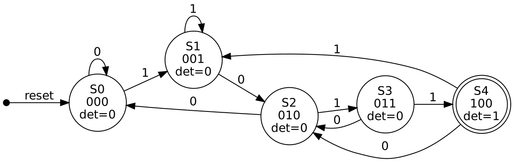
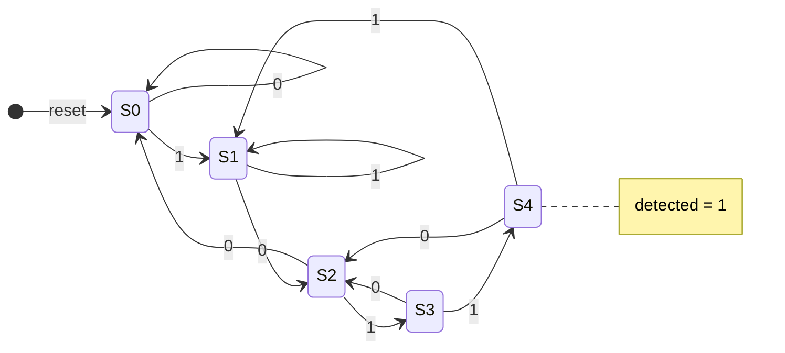

# Part II: Overlapping 1011 Sequence Detector (Moore FSM)

This is the Part II material for the report: the design (II.A), the self-checking testbench (II.B), the state diagram, the coverage argument and the timing table.

## II.A Design: `rtl/sequence_detector.sv`

* **Pattern.** Serial `1011` with overlapping detections. One `bit_in` sample is taken on each rising edge of `clk`.
* **Reset.** Synchronous and active high. On the edge where `reset = 1`, the state becomes S0 whatever `bit_in` is.
* **Output.** Moore style: `detected = (state == S4)`. It goes high after the edge that samples the final `1` of `1011` and stays high for exactly that one cycle.
* **Coding style.** `always_ff` holds the state register and `always_comb` holds the next-state `case` statement.
* **Encoding.** Binary with 3 bits: S0 = `000`, S1 = `001`, S2 = `010`, S3 = `011`, S4 = `100`.
* **Safe default.** `next_state` is set to S0 before the `case`, and a `default:` arm sends the unused encodings `101`, `110` and `111` back to S0. A corrupted state therefore recovers on the next edge and never produces a false `detected`.

| State | Encoding | Meaning (last useful prefix) | bit_in = 0 | bit_in = 1 | detected |
|---|---|---|---|---|---|
| S0 | 000 | no useful prefix | S0 | S1 | 0 |
| S1 | 001 | `1` | S2 | S1 | 0 |
| S2 | 010 | `10` | S0 | S3 | 0 |
| S3 | 011 | `101` | S2 | S4 | 0 |
| S4 | 100 | `1011` matched | S2 | S1 | 1 |
| unused | 101 / 110 / 111 | illegal | S0 | S0 | 0 |

### State diagram



(The image is rendered from `part2_state_diagram.dot`; there is also an SVG copy. The same diagram in Mermaid:)



Plain-text edge list (for slides if Mermaid is not rendered):

```
 reset ──► S0/0
 S0/0 ──0──► S0      S0/0 ──1──► S1
 S1/0 ──0──► S2      S1/0 ──1──► S1
 S2/0 ──0──► S0      S2/0 ──1──► S3
 S3/0 ──0──► S2      S3/0 ──1──► S4
 S4/1 ──0──► S2      S4/1 ──1──► S1        (state/detected)
```

The fallback transitions are what make overlap work. From S4 (`...1011`), a `0` leaves the suffix `10` (S2) and a `1` leaves the suffix `1` (S1). From S3 (`101`), a `0` leaves `10` (S2), not S0.

## II.B Testbench: `tb/tb_sequence_detector.sv`

### How expected values are derived (independent oracle)

The testbench is black box and never reads `dut.state` or the state encoding.

1. **Sliding-window oracle.** A 4-bit shift register holds the last four bits sampled since the most recent reset. The expected value is `detected = (window == 4'b1011)`. This follows straight from the specification and shares no logic with the FSM.
2. **Reset model.** A reset edge clears the window to `0000`. Because `1011` starts with `1`, the window cannot equal `1011` until four new bits have been sampled, so progress from before a reset can never count toward a match and no separate bit counter is needed.

### What is checked, and when

* `bit_in` and `reset` change on the falling edge and the DUT samples them on the rising edge.
* `detected` is checked **after every sampled bit**, 1 ns after the rising edge.
* `detected` must be 0 after every reset edge. During reset, `bit_in` is driven to 1 to prove it is ignored.
* **First-failure diagnostic.** The first mismatch prints a full report: stream, cycle, simulation time, bit index, the input history since reset, expected versus observed, and whether it was a *missed* or a *false* detection. Later mismatches print one line each. The run ends with `TEST FAILED` and `$fatal`, so the exit status is non-zero.
* **Timing table.** Every checked cycle is written to `sim/part2_timing.csv` with the columns cycle, stream, bit index, bit_in, expected detected and observed detected. The console log prints one PASS/FAIL line per stream.

### Streams (8 directed)

Every stream starts with its own reset, so streams do not depend on each other.

| # | Stream | Input | Requirement covered | Expected detections | Key transitions exercised |
|---|---|---|---|---|---|
| 1 | `basic_1011` | `1011` | single match | after bit 4 | S0→S1→S2→S3→S4 |
| 2 | `overlap_1011011` | `1011011` | overlap | after bits 4 and 7 | **S4 -0→ S2** (overlap) |
| 3 | `all_zeros` | `00000000` | no detections | none | S0 -0→ S0 |
| 4 | `all_ones` | `11111111` | no detections | none | S1 -1→ S1 |
| 5 | `near_miss_1010` | `1010` | no false positive | none | **S3 -0→ S2** |
| 6 | `near_miss_1110` | `1110` | no false positive | none | S1 -1→ S1, S1 -0→ S2 |
| 7 | `reset_mid_101` | `101`, reset, `1011` | mid-sequence reset | none until the new `1011`, then after its bit 4 | reset from S3; the `1` after reset must **not** detect |
| 8 | `long_mixed` | `11011 10011 0111011 01011 000 1011 0110 1110` (37 bits) | long stream, oracle only | 7 matches (bits 5, 13, 17, 22, 29, 32, 35) | all 10, including **S2 -0→ S0** and **S4 -1→ S1** |

The segments of `long_mixed` are chosen so that a wrong fallback transition changes a *later detection*, not only the hidden state:

* `11011`: S1 must stay in S1 on `1`.
* `10011`: S2 must drop to S0 on `0`.
* `0111011`: S4 must go to S1 on `1`.
* `01011`: S4 and S3 must fall back to S2 on `0`.

### State and transition coverage (by construction)

The spec requires the streams to collectively test all five states and both outcomes of the important fallback transitions. The testbench does not track this at run time; instead the stream inputs were traced through the specified state table (from the input bits alone, not from the DUT). The table counts how often the eight directed streams take each of the 10 (state, bit_in) transitions. Every cell is above zero, so all five states are reached and both outcomes of every fallback transition are exercised.

| From | Meaning | on 0 → | hits | on 1 → | hits |
|---|---|---|---:|---|---:|
| S0 | none | S0 | 9 | S1 | 10 |
| S1 | `1` | S2 | 12 | S1 | 11 |
| S2 | `10` | S0 | 2 | S3 | 14 |
| S3 | `101` | S2 | 2 | S4 | 11 |
| S4 | `1011` | S2 | 5 | S1 | 3 |

### Results (correct RTL)

```
=== Summary: 88 checks, 0 error(s)
TEST PASSED
PART II REGRESSION: PASS
```

88 checks = 78 sampled bits + 10 reset edges, with 11 expected detections. It passes under both Icarus Verilog 12.0 and Verilator 5.020.

### Testbench strength check (informal; not Part III)

To confirm that the testbench can expose missing or incorrect transitions, seven faulty copies of the FSM were simulated in a scratch folder. They are not part of the submission, and the official RTL was not edited. Each one failed:

| Injected fault | First failing stream | Observation |
|---|---|---|
| S4 -0→ S0 (no overlap) | `overlap_1011011` | missed detection at bit 7 |
| S3 -0→ S0 | `long_mixed` | missed detection at bit 22 |
| S1 -1→ S0 | `long_mixed` | missed detection at bit 5 (after `11011`) |
| S2 -0→ S2 | `long_mixed` | false detection at bit 10 (after `10011`) |
| S4 -1→ S0 | `long_mixed` | missed detection at bit 17 (after `0111011`) |
| Mealy output `(state==S3)&&bit_in` | `basic_1011` | false detection at bit 3 (output one cycle early) |
| reset ignored | `near_miss_1110` | false detection at bit 1 (progress left over from the previous stream is not cleared) |

Example diagnostic for the "no overlap" fault (`DUT_SRC=<faulty file> bash scripts/run_part2.sh`):

```
******************** FIRST MISMATCH ********************
  stream    : overlap_1011011
  cycle     : 14 (time 136000)
  bit index : 7 (since last reset), bit_in = 1
  history   : 1011011
  expected  : detected = 1
  observed  : detected = 0
  diagnosis : MISSED detection (history ends in 1011)
********************************************************
```

### Reproduction

Run from the folder that contains `rtl/`, `tb/` and `scripts/`:

```bash
bash scripts/run_part2.sh                  # Icarus Verilog (iverilog -g2012)
SIM=verilator bash scripts/run_part2.sh    # Verilator --binary --timing
DUT_SRC=path/to/other_detector.sv bash scripts/run_part2.sh   # run the same TB on another DUT copy
```

To run it by hand:

```bash
iverilog -g2012 -Wall -o part2.vvp rtl/sequence_detector.sv tb/tb_sequence_detector.sv
vvp -n part2.vvp
```

The outputs are `sim/part2.log` (console transcript) and `sim/part2_timing.csv` (cycle-by-cycle table).

Tool versions: Icarus Verilog 12.0 (stable) and Verilator 5.020 (2024-01-01), on Ubuntu 24.04.

### Limitations

* Directed simulation shows correct behavior on the sequences applied. It is not a formal proof for all input sequences, but because the streams take all 10 transitions of this 5-state machine (see the coverage table), every next-state entry is exercised.
* `detected` is checked only 1 ns after each rising edge, as the spec requires. The testbench does not separately check that `detected` stays stable while `bit_in` changes mid-cycle; a Moore output is guaranteed by the RTL (`detected = (state == S4)`) and by code review. A Mealy-style bug still shows up as a wrong value after an edge (see the strength check).
* The unused encodings (`101` to `111`) cannot be reached from the ports, so the black-box testbench does not exercise their recovery to S0. Only code review covers it.
* `reset` is only asserted at the start of a stream and once in the middle of stream 7. Reset asserted for several consecutive cycles, or released in the middle of a match, is covered only indirectly.
* Timing is a zero-delay functional simulation. Setup and hold are not modeled.

## Timing table (streams 1 to 8)

Cycle is the rising-edge count since time 0 (cycle 1 is the initial reset edge). The "reset" rows are the reset edges, and the "bit #" column restarts after each reset. The same data is in `sim/part2_timing.csv`.

**Stream 1: `basic_1011`**

| cycle | bit # | bit_in | expected detected | observed detected |
|---:|---:|:---:|:---:|:---:|
| 2 | reset | - | 0 | 0 |
| 3 | 1 | 1 | 0 | 0 |
| 4 | 2 | 0 | 0 | 0 |
| 5 | 3 | 1 | 0 | 0 |
| 6 | 4 | 1 | 1 | 1 |

**Stream 2: `overlap_1011011`**

| cycle | bit # | bit_in | expected detected | observed detected |
|---:|---:|:---:|:---:|:---:|
| 7 | reset | - | 0 | 0 |
| 8 | 1 | 1 | 0 | 0 |
| 9 | 2 | 0 | 0 | 0 |
| 10 | 3 | 1 | 0 | 0 |
| 11 | 4 | 1 | 1 | 1 |
| 12 | 5 | 0 | 0 | 0 |
| 13 | 6 | 1 | 0 | 0 |
| 14 | 7 | 1 | 1 | 1 |

**Stream 3: `all_zeros`**

| cycle | bit # | bit_in | expected detected | observed detected |
|---:|---:|:---:|:---:|:---:|
| 15 | reset | - | 0 | 0 |
| 16 | 1 | 0 | 0 | 0 |
| 17 | 2 | 0 | 0 | 0 |
| 18 | 3 | 0 | 0 | 0 |
| 19 | 4 | 0 | 0 | 0 |
| 20 | 5 | 0 | 0 | 0 |
| 21 | 6 | 0 | 0 | 0 |
| 22 | 7 | 0 | 0 | 0 |
| 23 | 8 | 0 | 0 | 0 |

**Stream 4: `all_ones`**

| cycle | bit # | bit_in | expected detected | observed detected |
|---:|---:|:---:|:---:|:---:|
| 24 | reset | - | 0 | 0 |
| 25 | 1 | 1 | 0 | 0 |
| 26 | 2 | 1 | 0 | 0 |
| 27 | 3 | 1 | 0 | 0 |
| 28 | 4 | 1 | 0 | 0 |
| 29 | 5 | 1 | 0 | 0 |
| 30 | 6 | 1 | 0 | 0 |
| 31 | 7 | 1 | 0 | 0 |
| 32 | 8 | 1 | 0 | 0 |

**Stream 5: `near_miss_1010`**

| cycle | bit # | bit_in | expected detected | observed detected |
|---:|---:|:---:|:---:|:---:|
| 33 | reset | - | 0 | 0 |
| 34 | 1 | 1 | 0 | 0 |
| 35 | 2 | 0 | 0 | 0 |
| 36 | 3 | 1 | 0 | 0 |
| 37 | 4 | 0 | 0 | 0 |

**Stream 6: `near_miss_1110`**

| cycle | bit # | bit_in | expected detected | observed detected |
|---:|---:|:---:|:---:|:---:|
| 38 | reset | - | 0 | 0 |
| 39 | 1 | 1 | 0 | 0 |
| 40 | 2 | 1 | 0 | 0 |
| 41 | 3 | 1 | 0 | 0 |
| 42 | 4 | 0 | 0 | 0 |

**Stream 7: `reset_mid_101`**

| cycle | bit # | bit_in | expected detected | observed detected |
|---:|---:|:---:|:---:|:---:|
| 43 | reset | - | 0 | 0 |
| 44 | 1 | 1 | 0 | 0 |
| 45 | 2 | 0 | 0 | 0 |
| 46 | 3 | 1 | 0 | 0 |
| 47 | reset | - | 0 | 0 |
| 48 | 1 | 1 | 0 | 0 |
| 49 | 2 | 0 | 0 | 0 |
| 50 | 3 | 1 | 0 | 0 |
| 51 | 4 | 1 | 1 | 1 |

**Stream 8: `long_mixed`**

| cycle | bit # | bit_in | expected detected | observed detected |
|---:|---:|:---:|:---:|:---:|
| 52 | reset | - | 0 | 0 |
| 53 | 1 | 1 | 0 | 0 |
| 54 | 2 | 1 | 0 | 0 |
| 55 | 3 | 0 | 0 | 0 |
| 56 | 4 | 1 | 0 | 0 |
| 57 | 5 | 1 | 1 | 1 |
| 58 | 6 | 1 | 0 | 0 |
| 59 | 7 | 0 | 0 | 0 |
| 60 | 8 | 0 | 0 | 0 |
| 61 | 9 | 1 | 0 | 0 |
| 62 | 10 | 1 | 0 | 0 |
| 63 | 11 | 0 | 0 | 0 |
| 64 | 12 | 1 | 0 | 0 |
| 65 | 13 | 1 | 1 | 1 |
| 66 | 14 | 1 | 0 | 0 |
| 67 | 15 | 0 | 0 | 0 |
| 68 | 16 | 1 | 0 | 0 |
| 69 | 17 | 1 | 1 | 1 |
| 70 | 18 | 0 | 0 | 0 |
| 71 | 19 | 1 | 0 | 0 |
| 72 | 20 | 0 | 0 | 0 |
| 73 | 21 | 1 | 0 | 0 |
| 74 | 22 | 1 | 1 | 1 |
| 75 | 23 | 0 | 0 | 0 |
| 76 | 24 | 0 | 0 | 0 |
| 77 | 25 | 0 | 0 | 0 |
| 78 | 26 | 1 | 0 | 0 |
| 79 | 27 | 0 | 0 | 0 |
| 80 | 28 | 1 | 0 | 0 |
| 81 | 29 | 1 | 1 | 1 |
| 82 | 30 | 0 | 0 | 0 |
| 83 | 31 | 1 | 0 | 0 |
| 84 | 32 | 1 | 1 | 1 |
| 85 | 33 | 0 | 0 | 0 |
| 86 | 34 | 1 | 0 | 0 |
| 87 | 35 | 1 | 1 | 1 |
| 88 | 36 | 1 | 0 | 0 |
| 89 | 37 | 0 | 0 | 0 |

